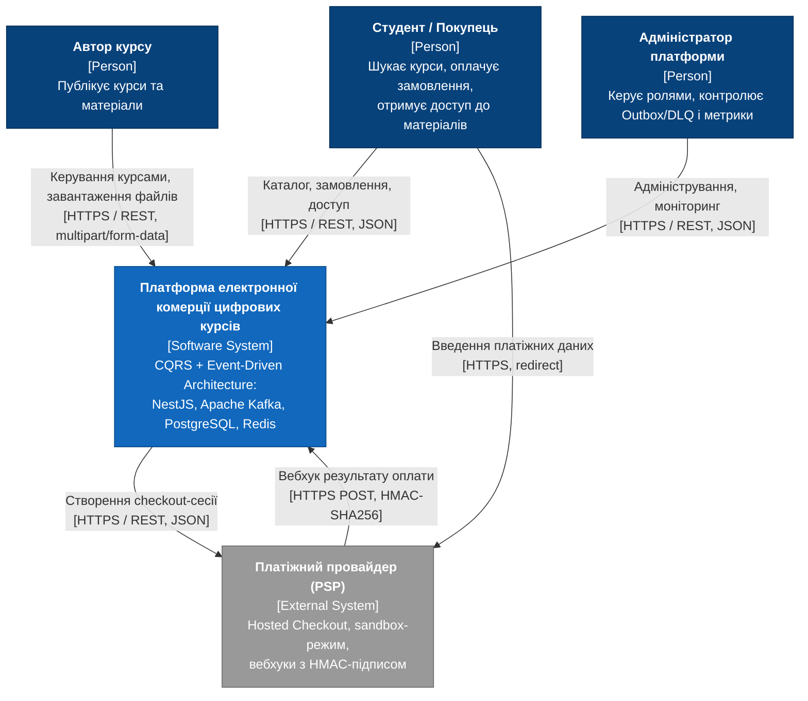
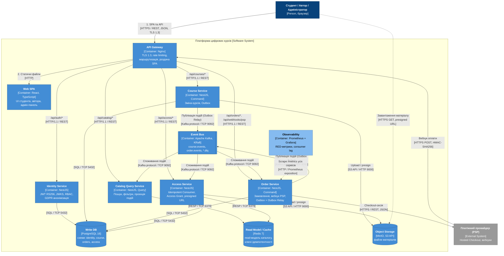
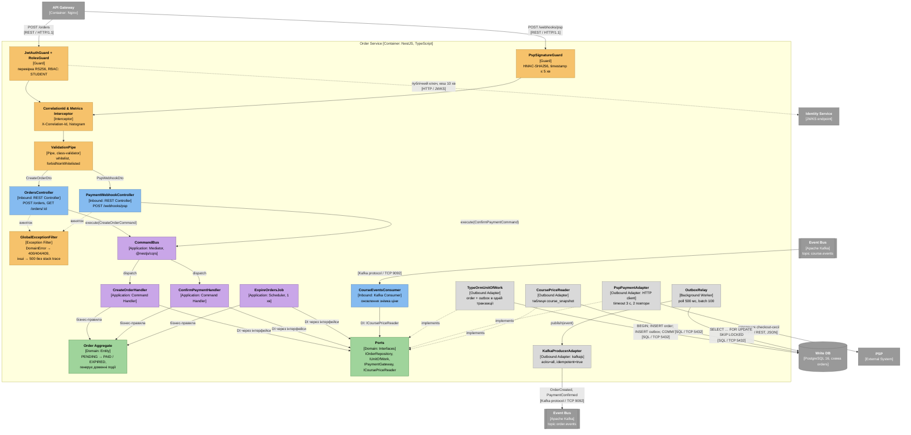

# РОЗДІЛ 2. ПРОЄКТУВАННЯ АРХІТЕКТУРИ СИСТЕМИ

> Архітектура описана за ієрархічною моделлю C4 (Simon Brown) за підходом Diagrams-as-Code (Mermaid.js).
> Вхідний контракт вимог — [Специфікація вимог (SRS)](./srs.md). Архітектурні компроміси — каталог [ADR](./adr/).
>
> **Нотація.** Діаграми виконано синтаксисом `flowchart` Mermaid з нотацією C4: тип елемента вказано в квадратних дужках (`[Person]`, `[Container: …]`, `[Component]`), технологія/протокол зв'язку — у підписі стрілки. Колір: темно-синій — актори, синій — контейнери системи, сірий — зовнішні системи та контейнери поза межами діаграми.

## Зміст

- [2.1. Контекстне та контейнерне моделювання системи (C4 Model)](#21-контекстне-та-контейнерне-моделювання-системи-c4-model)
  - [2.1.1. C4 Level 1 — System Context Diagram](#211-c4-level-1--system-context-diagram)
  - [2.1.2. C4 Level 2 — Container Diagram](#212-c4-level-2--container-diagram)
- [2.2. Компонентне моделювання критичного сервісу системи](#22-компонентне-моделювання-критичного-сервісу-системи)
- [2.3. Документування архітектурних рішень (Architecture Decision Records)](#23-документування-архітектурних-рішень-architecture-decision-records)
- [2.4. Матриця трасування «Вимога → Архітектурний елемент»](#24-матриця-трасування-вимога--архітектурний-елемент)

---

## 2.1. Контекстне та контейнерне моделювання системи (C4 Model)

### 2.1.1. C4 Level 1 — System Context Diagram

#### Опис елементів та зв'язків

| Елемент | Тип | Роль | Трасування |
| :--- | :--- | :--- | :--- |
| Студент / Покупець | Person | Пошук курсів, оформлення замовлення, отримання доступу до матеріалів. | [SRS-FUN-11](./srs.md#srs-fun-11), [SRS-FUN-13](./srs.md#srs-fun-13), [SRS-FUN-23](./srs.md#srs-fun-23) |
| Автор курсу | Person | Створення та редагування курсів, завантаження файлів матеріалів. | [SRS-FUN-07](./srs.md#srs-fun-07), [SRS-FUN-08](./srs.md#srs-fun-08) |
| Адміністратор платформи | Person | Керування ролями, контроль Outbox/DLQ, перегляд метрик. | [SRS-FUN-06](./srs.md#srs-fun-06), [SRS-FUN-25](./srs.md#srs-fun-25), [SRS-FUN-26](./srs.md#srs-fun-26) |
| Платформа | Software System | Межі системи згідно з [SRS, розділ 2.1](./srs.md#21-межі-системи-scope). | — |
| Платіжний провайдер (PSP) | External System | Hosted Checkout та асинхронне повідомлення про результат оплати. Дані платіжних карток вводяться лише на сторінці PSP. | [SRS-FUN-16](./srs.md#srs-fun-16), [SRS-FUN-17](./srs.md#srs-fun-17), [SRS-NFR-SEC-07](./srs.md#srs-nfr-sec-07) |

| Зв'язок | Протокол | Призначення |
| :--- | :--- | :--- |
| Актори → Платформа | HTTPS / REST, JSON (multipart/form-data для файлів) | Усі сценарії користувача через Web SPA; TLS 1.3 ([SRS-NFR-SEC-01](./srs.md#srs-nfr-sec-01)). |
| Платформа → PSP | HTTPS / REST, JSON | Створення checkout-сесії ([SRS-FUN-16](./srs.md#srs-fun-16)). |
| PSP → Платформа | HTTPS POST, підпис HMAC-SHA256 | Вебхук результату оплати ([SRS-NFR-SEC-05](./srs.md#srs-nfr-sec-05)). |
| Студент → PSP | HTTPS, redirect | Введення платіжних даних на стороні PSP ([SRS-NFR-SEC-07](./srs.md#srs-nfr-sec-07)). |

### 2.1.2. C4 Level 2 — Container Diagram

#### Опис контейнерів

| Контейнер | Технологія | Відповідальність | Реалізує вимоги |
| :--- | :--- | :--- | :--- |
| Web SPA | React, TypeScript, React Query, Tailwind CSS | UI студента, автора та адмін-панель; зберігає access token у пам'яті, refresh token — у cookie `HttpOnly; Secure; SameSite=Strict`. | [SRS-FUN-11](./srs.md#srs-fun-11), [SRS-FUN-25](./srs.md#srs-fun-25) |
| API Gateway | Nginx | Єдина точка входу: TLS 1.3 termination, rate limiting (`limit_req`), маршрутизація за префіксом шляху, роздача статики SPA, генерація `X-Correlation-Id`. | [SRS-NFR-SEC-01](./srs.md#srs-nfr-sec-01), [SRS-NFR-SEC-04](./srs.md#srs-nfr-sec-04), [SRS-NFR-OBS-02](./srs.md#srs-nfr-obs-02) |
| Identity Service | NestJS | Реєстрація, видача та ротація JWT RS256, JWKS-endpoint, RBAC, анонімізація за GDPR. | [SRS-FUN-01](./srs.md#srs-fun-01)…[SRS-FUN-06](./srs.md#srs-fun-06), [SRS-NFR-SEC-02](./srs.md#srs-nfr-sec-02), [SRS-NFR-SEC-03](./srs.md#srs-nfr-sec-03) |
| Course Service | NestJS (Command side) | Зміна курсів авторами, завантаження файлів у MinIO, запис `CourseUpserted` в Outbox. | [SRS-FUN-07](./srs.md#srs-fun-07), [SRS-FUN-08](./srs.md#srs-fun-08), [SRS-FUN-09](./srs.md#srs-fun-09) |
| Catalog Query Service | NestJS (Query side) | Проєкція `course.events` у read-модель Redis; пошук і фільтрація без звернення до PostgreSQL. | [SRS-FUN-10](./srs.md#srs-fun-10), [SRS-FUN-11](./srs.md#srs-fun-11), [SRS-FUN-12](./srs.md#srs-fun-12), [SRS-NFR-PERF-02](./srs.md#srs-nfr-perf-02) |
| Order Service | NestJS (Command side) | Життєвий цикл замовлення, інтеграція з PSP, Transactional Outbox, Outbox Relay. Деталізація — [C4 Level 3](#diagram-level3). | [SRS-FUN-13](./srs.md#srs-fun-13)…[SRS-FUN-19](./srs.md#srs-fun-19), [SRS-NFR-PERF-03](./srs.md#srs-nfr-perf-03) |
| Access Service | NestJS | Idempotent Consumer `PaymentConfirmed`, Access Grant, presigned URL. | [SRS-FUN-21](./srs.md#srs-fun-21)…[SRS-FUN-24](./srs.md#srs-fun-24), [SRS-NFR-REL-02](./srs.md#srs-nfr-rel-02) |
| Event Bus | Apache Kafka 4.x (KRaft) | Топіки `course.events`, `order.events`, `*.dlq`; 3 партиції, ключ `aggregateId`. Рішення — [ADR-001](./adr/0001-choice-of-technology.md). | [SRS-FUN-19](./srs.md#srs-fun-19), [SRS-FUN-20](./srs.md#srs-fun-20), [SRS-NFR-REL-01](./srs.md#srs-nfr-rel-01), [SRS-NFR-SCAL-02](./srs.md#srs-nfr-scal-02) |
| Write DB | PostgreSQL 16 | Окрема схема та окремий користувач БД для кожного сервісу (database-per-service на рівні схем). | [SRS-NFR-REL-05](./srs.md#srs-nfr-rel-05) |
| Read Model / Cache | Redis 7 | Read-модель каталогу (Hash + Sorted Set для фільтрів), ключі ідемпотентності з TTL 7 діб. | [SRS-FUN-10](./srs.md#srs-fun-10), [SRS-NFR-REL-02](./srs.md#srs-nfr-rel-02) |
| Object Storage | MinIO (S3 API) | Приватний bucket з файлами матеріалів; доступ лише за presigned URL. | [SRS-FUN-08](./srs.md#srs-fun-08), [SRS-FUN-23](./srs.md#srs-fun-23) |
| Observability | Prometheus, Grafana | Збір метрик `/metrics` усіх сервісів і Kafka (consumer lag), дашборди для адміністратора. | [SRS-NFR-OBS-01](./srs.md#srs-nfr-obs-01), [SRS-NFR-PERF-04](./srs.md#srs-nfr-perf-04) |

#### Специфікація протоколів взаємодії

| Від → До | Протокол / порт | Примітка |
| :--- | :--- | :--- |
| Браузер → API Gateway | HTTPS (TLS 1.3) / 443, REST, JSON | Rate limiting: 20 req/s на IP; 5 req/хв на IP для `/api/auth/login`. |
| API Gateway → сервіси | HTTP/1.1 / 3000, REST, JSON | Внутрішня мережа Docker; заголовок `X-Correlation-Id`. |
| PSP → API Gateway | HTTPS POST / 443 | Тіло вебхука передається в Order Service без змін для перевірки HMAC. |
| Order Service → PSP | HTTPS / 443, REST, JSON | Timeout 3 с, 2 повтори, ключ ідемпотентності = `orderId`. |
| Сервіси → PostgreSQL | SQL / TCP 5432 (TypeORM, пул з'єднань) | — |
| Course, Order → Kafka | Kafka protocol / TCP 9092 | Лише через Outbox Relay; `acks=all`, idempotent producer. |
| Kafka → Catalog Query, Order, Access | Kafka protocol / TCP 9092 | Consumer groups `catalog-query`, `order-price-snapshot`, `access`. |
| Catalog Query, Access → Redis | RESP / TCP 6379 | — |
| Course, Access → MinIO | S3 API / HTTP 9000 | Upload (Course), генерація presigned URL (Access). |
| Браузер → MinIO | HTTPS GET, presigned URL | Строк дії 15 хв ([SRS-FUN-23](./srs.md#srs-fun-23)). |
| Сервіси → Identity Service | HTTP / JWKS (`/.well-known/jwks.json`) | Кешування публічного ключа на 10 хв; на діаграмі не показано для читабельності. |
| Prometheus → сервіси | HTTP / Prometheus exposition format | Scrape кожні 15 с; на діаграмі показано один зв'язок. |

---

## 2.2. Компонентне моделювання критичного сервісу системи

**Обраний сервіс:** Order Service (NestJS, TypeScript). Обґрунтування вибору: сервіс одночасно виконує фінансову транзакцію, інтегрується із зовнішнім PSP, приймає вебхуки з неперевіреного периметра та є джерелом подій `OrderCreated` і `PaymentConfirmed`, від яких залежить видача доступу. Відмова або дефект цього сервісу безпосередньо порушує [SRS-NFR-REL-01](./srs.md#srs-nfr-rel-01) та [SRS-NFR-PERF-03](./srs.md#srs-nfr-perf-03).

### Опис компонентів

| Компонент | Шар | Роль | Взаємодія |
| :--- | :--- | :--- | :--- |
| JwtAuthGuard + RolesGuard | Cross-cutting (Guard) | Перевірка підпису RS256 і строку дії JWT; перевірка ролі `STUDENT` для `POST /orders`. | Декоратор `@UseGuards`; публічний ключ — з JWKS Identity Service ([SRS-FUN-04](./srs.md#srs-fun-04), [SRS-NFR-SEC-02](./srs.md#srs-nfr-sec-02)). |
| PspSignatureGuard | Cross-cutting (Guard) | Перевірка HMAC-SHA256 підпису та часової мітки вебхука; відхилення — HTTP 401. | `@UseGuards` на `PaymentWebhookController` ([SRS-NFR-SEC-05](./srs.md#srs-nfr-sec-05)). |
| CorrelationId & Metrics Interceptor | Cross-cutting (Interceptor) | Прокидання `X-Correlation-Id` у логи та заголовки подій; гістограма `http_request_duration_seconds`. | Глобальний `APP_INTERCEPTOR` ([SRS-NFR-OBS-01](./srs.md#srs-nfr-obs-01), [SRS-NFR-OBS-02](./srs.md#srs-nfr-obs-02)). |
| ValidationPipe | Cross-cutting (Pipe) | Валідація DTO (`class-validator`), відхилення невідомих полів — HTTP 400. | Глобальний pipe ([SRS-NFR-SEC-06](./srs.md#srs-nfr-sec-06)). |
| GlobalExceptionFilter | Cross-cutting (Filter) | Відображення доменних помилок у коди HTTP (`OrderAlreadyExists` → 409); приховування stack trace. | Глобальний `APP_FILTER` ([SRS-FUN-14](./srs.md#srs-fun-14)). |
| OrdersController | Inbound | REST-адаптер: перетворює DTO на `CreateOrderCommand`. Не містить бізнес-логіки й не звертається до БД. | `CommandBus.execute()` |
| PaymentWebhookController | Inbound | REST-адаптер вебхука: перетворює DTO на `ConfirmPaymentCommand`. | `CommandBus.execute()` |
| CourseEventsConsumer | Inbound | Kafka-консюмер `course.events`: оновлює локальний знімок ціни курсу (таблиця `course_snapshot`), що усуває синхронну залежність від Catalog Query Service ([SRS-NFR-REL-03](./srs.md#srs-nfr-rel-03)). | Порт `ICoursePriceReader` |
| CommandBus | Application | Mediator (`@nestjs/cqrs`): маршрутизація команд до обробників. | Патерн Mediator |
| CreateOrderHandler | Application | Сценарій створення замовлення: перевірка дубліката, фіксація ціни, збереження замовлення та події в одній транзакції, створення checkout-сесії PSP. | Порти `IUnitOfWork`, `ICoursePriceReader`, `IPaymentGateway` ([SRS-FUN-13](./srs.md#srs-fun-13), [SRS-FUN-15](./srs.md#srs-fun-15), [SRS-FUN-16](./srs.md#srs-fun-16)) |
| ConfirmPaymentHandler | Application | Перехід `PENDING → PAID` та запис `PaymentConfirmed` в Outbox; повторний вебхук для `PAID`-замовлення ігнорується. | Порт `IUnitOfWork` ([SRS-FUN-17](./srs.md#srs-fun-17)) |
| ExpireOrdersJob | Application | Переведення замовлень `PENDING` старших за 30 хв у `EXPIRED`. | `@nestjs/schedule` ([SRS-FUN-18](./srs.md#srs-fun-18)) |
| Order Aggregate | Domain | Інваріанти та переходи станів; генерує доменні події. Не залежить від NestJS, TypeORM і Kafka. | Чистий TypeScript |
| Ports | Domain | Інтерфейси `IOrderRepository`, `IUnitOfWork`, `IPaymentGateway`, `ICoursePriceReader`. | Dependency Inversion Principle: application-шар залежить від абстракцій, адаптери їх реалізують. |
| TypeOrmUnitOfWork | Outbound | Транзакція `order + outbox` через `QueryRunner` ([SRS-FUN-15](./srs.md#srs-fun-15)). | SQL / TCP 5432 |
| PspPaymentAdapter | Outbound | HTTP-клієнт PSP: timeout 3 с, 2 повтори, `Idempotency-Key`. Викликається після коміту транзакції, щоб мережевий виклик не утримував з'єднання з БД. | HTTPS / REST |
| CoursePriceReader | Outbound | Читання знімка ціни з `course_snapshot`. | SQL / TCP 5432 |
| OutboxRelay | Background Worker | Вибірка неопублікованих записів `SELECT … FOR UPDATE SKIP LOCKED` (безпечно для кількох реплік), публікація, позначка `published_at` ([SRS-FUN-19](./srs.md#srs-fun-19)). | SQL / TCP 5432 |
| KafkaProducerAdapter | Outbound | Продюсер `kafkajs` з `acks=all`, `idempotent=true`, ключ партиції `orderId`. | Kafka protocol / TCP 9092 ([ADR-001](./adr/0001-choice-of-technology.md)) |

### Принципи, дотримані на рівні компонентів

- **Clean Architecture:** залежності спрямовані всередину (Inbound → Application → Domain ← Outbound). Контролери не мають доступу до репозиторіїв.
- **Dependency Inversion (SOLID-D):** обробники отримують порти через DI-контейнер NestJS (`@Inject(ORDER_REPOSITORY)`); адаптери TypeORM, PSP та Kafka замінюються в тестах на in-memory реалізації.
- **Single Responsibility (SOLID-S):** публікація подій винесена з обробників у `OutboxRelay`; обробник не знає про Kafka.
- **Request pipeline NestJS:** Guard → Interceptor → Pipe → Controller → Exception Filter.

---

## 2.3. Документування архітектурних рішень (Architecture Decision Records)

| ID | Рішення | Статус | Пов'язані вимоги |
| :--- | :--- | :--- | :--- |
| [ADR-001](./adr/0001-choice-of-technology.md) | Вибір брокера доменних подій — Apache Kafka замість RabbitMQ | Approved | [SRS-FUN-10](./srs.md#srs-fun-10), [SRS-FUN-19](./srs.md#srs-fun-19), [SRS-FUN-20](./srs.md#srs-fun-20), [SRS-NFR-REL-01](./srs.md#srs-nfr-rel-01), [SRS-NFR-REL-02](./srs.md#srs-nfr-rel-02) |

---

## 2.4. Матриця трасування «Вимога → Архітектурний елемент»

| Вимога | Контейнер (Level 2) | Компонент (Level 3) | Рішення |
| :--- | :--- | :--- | :--- |
| [SRS-FUN-04](./srs.md#srs-fun-04) | Identity Service, усі сервіси | JwtAuthGuard + RolesGuard | — |
| [SRS-FUN-10](./srs.md#srs-fun-10) | Catalog Query Service, Redis, Kafka | — | [ADR-001](./adr/0001-choice-of-technology.md) |
| [SRS-FUN-13](./srs.md#srs-fun-13) | Order Service | CreateOrderHandler, Order Aggregate | — |
| [SRS-FUN-14](./srs.md#srs-fun-14) | Order Service | CreateOrderHandler, GlobalExceptionFilter | — |
| [SRS-FUN-15](./srs.md#srs-fun-15) | Order Service, PostgreSQL | TypeOrmUnitOfWork | [ADR-001](./adr/0001-choice-of-technology.md) |
| [SRS-FUN-16](./srs.md#srs-fun-16) | Order Service, PSP | PspPaymentAdapter | — |
| [SRS-FUN-17](./srs.md#srs-fun-17) | Order Service | PaymentWebhookController, PspSignatureGuard, ConfirmPaymentHandler | — |
| [SRS-FUN-18](./srs.md#srs-fun-18) | Order Service | ExpireOrdersJob | — |
| [SRS-FUN-19](./srs.md#srs-fun-19) | Order Service, Kafka | OutboxRelay, KafkaProducerAdapter | [ADR-001](./adr/0001-choice-of-technology.md) |
| [SRS-FUN-22](./srs.md#srs-fun-22) | Access Service, Redis, PostgreSQL | — | [ADR-001](./adr/0001-choice-of-technology.md) |
| [SRS-NFR-SEC-04](./srs.md#srs-nfr-sec-04) | API Gateway | — | — |
| [SRS-NFR-SEC-05](./srs.md#srs-nfr-sec-05) | Order Service | PspSignatureGuard | — |
| [SRS-NFR-SEC-06](./srs.md#srs-nfr-sec-06) | Усі бекенд-сервіси | ValidationPipe | — |
| [SRS-NFR-OBS-02](./srs.md#srs-nfr-obs-02) | API Gateway, усі сервіси | CorrelationId & Metrics Interceptor | — |
